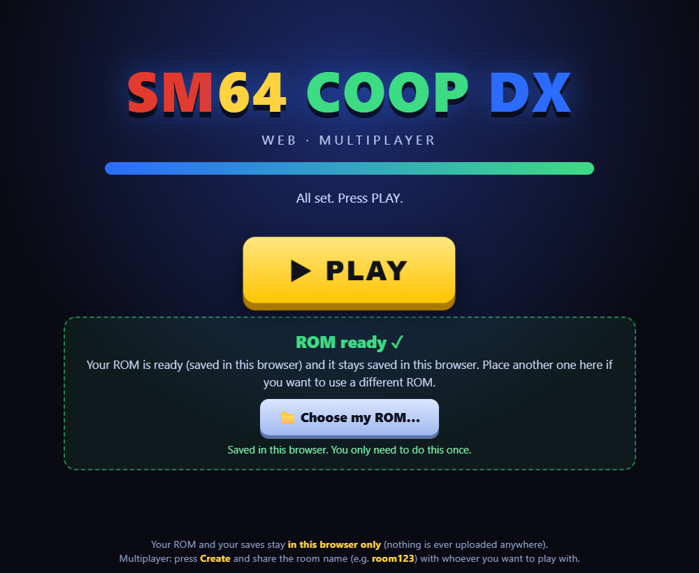

# sm64coopdx — Web port (WebAssembly)

[sm64coopdx](https://github.com/coop-deluxe/sm64coopdx) **running inside the browser**: the whole game is compiled to WebAssembly with [Emscripten](https://emscripten.org/), renders with WebGL and keeps the mods, the DJUI menus and the **online multiplayer** working between browsers. Since a browser cannot send UDP, the players' packets travel through a tiny WebSocket relay that also serves the page.

This fork is the upstream desktop port plus a `TARGET_WEB=1` build target and the pieces needed to run it in a page (`web/`).



> ### No ROM is included
> Just like the desktop port, **you need your own copy of Super Mario 64 (USA)**. The page asks for it once, checks its MD5 and stores it **only in your browser** (IndexedDB) — it is never uploaded anywhere. Builds can be shared freely *as long as they don't have a ROM baked in*.

## What works

* The full game, rendered through WebGL (the same GLES2/GLSL ES 1.00 shaders as the Raspberry Pi build).
* The DJUI menus (options, mods list, chat, host/join).
* **Online multiplayer between browsers**, through the relay in `web/relay/relay.js`.
* **Your progress is saved in the browser**: saves, mods and `sm64config.txt` survive a page reload.
* **Mods from the browser**: the "open mods folder" buttons open a file picker, and the game's own importer takes it from there (mods, dynos packs and palettes).
* A custom loading screen with a PLAY button — the click is what lets the page go fullscreen and start the audio.

## Using it

### 1. Serve the page

```bash
node web/relay/relay.js build/us_pc
```

Then open **http://localhost:4321/sm64coopdx.html**. The relay serves the game files *and* acts as the room server, so one process and one port is all you need.

### 2. Place your ROM and press PLAY

The loading screen asks for your `Super Mario 64 (USA)` ROM:

* Accepts `.z64`, `.n64` and `.v64` (byte-swapped dumps are converted automatically).
* The MD5 of the (U) ROM is `20b854b239203baf6c961b850a4a51a2`.
* Drag and drop onto the page also works.

You only have to do this once per browser. Then press **PLAY**.

## Multiplayer

* **Create**: you are asked for a room name (e.g. `sala123`) — share that name with your friends.
* **Join**: the game lists the open rooms of the relay and you click the one you want.
* No relay reachable? The game just starts in single player.

**On your LAN:** your friends open `http://YOUR-LOCAL-IP:4321/sm64coopdx.html` and press *Join*. If they don't see your room, allow port `4321` in the Windows firewall.

**Over the internet (no port forwarding):**

```bash
cloudflared tunnel --url http://localhost:4321
```

Share the `https://something.trycloudflare.com` URL. The page and the relay go through the same tunnel (Cloudflare supports WebSockets) and the game finds the relay by itself, since it uses the same host the page was served from.

**Hosting the relay** (Render, Railway, Fly…) also works, and you can point the page at it with `?relay=your-relay.example.com`. See [web/relay/README.md](web/relay/README.md) for the details and the frame protocol.

## Your ROM, your saves, your mods

Everything lives in the game's write directory, which is mounted on **IndexedDB**:

| What | Where |
|---|---|
| ROM | written once, at startup |
| Progress | `saves/` |
| Mods | `mods/` |
| Settings | `sm64config.txt` |

The game keeps using its normal `fopen()` calls, and `web/pre.js` flushes the writable filesystem to IndexedDB at startup and every 10 seconds. To start from scratch, clear the site data in your browser.

**Keep only one game tab open at a time.** All tabs of the same address share the same browser storage, and the last one to flush wins, so two tabs can overwrite each other's saves.

## Mods

The "open folder" buttons (mods, dynos, save folder) are not dead ends in the web build: they open a picker where you choose a **mod folder** or **`.zip` file(s)**. The files are copied into the game's storage and imported by the game's own `mod_import_file()`, exactly the same code path as dragging and dropping a mod onto the desktop build — so mods, dynos packs and palettes all behave as usual.

## Building it yourself

**Requirements:** an active [emsdk](https://emscripten.org/docs/getting_started/downloads.html) with `emcc`, `em++` and `emar` on the `PATH` (Emscripten 4). Lua 5.3 compiled for WebAssembly is already in the repo (`lib/lua/web64/liblua53.a`), so nothing else is needed.

```bash
make -j8 CC=emcc CXX=em++ AR=emar AS=emcc CPP=cpp \
     TARGET_WEB=1 WINDOWS_BUILD=0 ICON=0 WINDOWS_AUTO_BUILDER=1
```

The result lands in `build/us_pc/`:

| File | What it is |
|---|---|
| `sm64coopdx.html` | the page (it uses `web/shell.html`, not Emscripten's default shell) |
| `sm64coopdx.js` | the JS glue, including `web/pre.js` (browser storage + ROM) |
| `sm64coopdx.wasm` | the game itself |
| `sm64coopdx.data` | assets (lang, mods, palettes, dynos — and the ROM, if one was embedded) |

The build is a **wasm64** one (`-m64`, MEMORY64): the pre-compressed sound blobs that ship in the repo are laid out for a 64-bit host, so 32-bit pointers would read garbage out of them.

**For local testing only**, you can bake your own ROM into a build with `WEB_ROM="/path/to/baserom.us.z64"`. Never share that build.

## How the web port is wired

| File | Role |
|---|---|
| `web/shell.html` | loading screen, ROM panel, PLAY button (Emscripten `--shell-file`) |
| `web/pre.js` | mounts IDBFS and exposes the ROM writing helper (`--pre-js`) |
| `web/relay/relay.js` | WebSocket relay + static file server |
| `src/pc/network/socket/socket_web.c` | virtual sockets on top of WebSocket (the game thinks it is talking UDP) |
| `src/pc/fs/fs.c`, `src/pc/platform.c` | the write directory that gets persisted |
| `src/pc/pc_main.c` | copies an embedded ROM (if any) and flushes the saves every 10 s |
| `Makefile` (`TARGET_WEB=1`) | the Emscripten flags, ports and preloads |

The web build uses `-sINVOKE_RUN=0`: `main()` does not start on its own. The PLAY button calls it once IndexedDB has been mounted and read (mounting it is asynchronous).

More details of the build and of the deployment in [web/README.md](web/README.md).

## Known limitations

* **One game tab at a time** (see above).
* The game runs at a fixed **30 steps per second**, driven by the game and not by the browser's frame rate. A hidden or unfocused tab stops the loop, so keep the game tab visible while playing.
* Single-threaded and GLES2: it is slower than the desktop build on the same machine.
* Online play needs the relay; there is no peer-to-peer path.
* The relay is a dumb forwarder: one host per room name, and everyone in a room receives everyone's packets.
* Tested on desktop Chrome and Edge. Other browsers are untested, and there are no touch controls (keyboard works; a gamepad should work through SDL2, untested).

## Credits

This is a fork of [sm64coopdx](https://github.com/coop-deluxe/sm64coopdx) by the Coop Deluxe Team, which continues [sm64ex-coop](https://github.com/djoslin0/sm64ex-coop) by djoslin0, built on sm64ex and the [Super Mario 64 decompilation project](https://github.com/n64decomp/sm64). All of that work is theirs; this fork only adds the web target on top.

* Upstream repository: <https://github.com/coop-deluxe/sm64coopdx>
* Lua modding documentation: [docs/lua/lua.md](docs/lua/lua.md)
* C documentation: [docs/c/c.md](docs/c/c.md)
* Upstream wiki: <https://github.com/coop-deluxe/sm64coopdx/wiki>
* Upstream Discord: <https://discord.gg/TJVKHS4>

Super Mario 64 is a trademark of Nintendo. This project is a fan-made port of the game's decompilation and is not affiliated with or endorsed by Nintendo. No copyrighted ROM is distributed here — bring your own.
